  

# Awesome Collaborative Code Review Software 🚀

  
  
  
  
  
  

> 🌟 **A curated list of battle-tested SaaS platforms, self-hosted open-source code review engines, and AI-assisted pull request review tools.** Focuses on pre-commit review, git diff inspection, inline comments, approval gates, and multi-VCS workflows.

---

## 📑 Table of Contents

- [📊 Sector Overview & Market Dynamics](#-sector-overview--market-dynamics)
- [🏢 SaaS & Hosted Platforms](#-saas--hosted-platforms)
- [⭐ Open-Source GitHub Projects](#-open-source-github-projects)
- [📈 Star History](#star-history)
- [🤝 How to Contribute](#-how-to-contribute)
- [💖 Support & Sponsorship](#-support--sponsorship)
- [⚠️ Disclaimer](#️-disclaimer)

---

## 📊 Sector Overview & Market Dynamics

The global collaborative code review, pull request management, and automated code inspection software market is valued at approximately **$1.1 billion to $4.2 billion** (scaling past $17 billion when evaluating the broader enterprise DevOps and DevSecOps platform lifecycle). 

The market dynamics exhibit **high concentration** around dominant code hosting ecosystems like Microsoft GitHub and GitLab—creating a near "winner-take-most" reality for standard pull request workflows. Concurrently, specialized independent tools (such as SmartBear Collaborator, Reviewable) and emerging LLM-powered review engines maintain strong niches across regulated industries, multi-VCS enterprises (Git, SVN, Mercurial, Perforce), and automated CI/CD linting infrastructure.

---

## 🏢 SaaS & Hosted Platforms

| 💻 Product | 🏢 Company Valuation / Scale | 💳 Pricing (Starting Tier) | 🎁 Free Tier / Free Trial Limits | 📝 Description & Best Use Case |
| :--- | :--- | :--- | :--- | :--- |
| **[GitHub Pull Requests](https://github.com/features/code-review)** | Parent: Microsoft ($3.1T+ Market Cap / ~$245B+ Rev); GitHub ARR ~$2B+ | **$4/user/month** (Team tier, billed monthly or $44/yr) | **Free forever plan**: Unlimited public/private repos, 2,000 CI/CD Actions minutes/month, and 500MB Packages storage for individuals and teams. | Native code review integrated directly with GitHub with inline suggestions, branch protection rules, draft PRs, and team review assignments. |
| **[Crucible](https://www.atlassian.com/software/crucible)** | Atlassian: ~$53.3B Market Cap / $5.22B FY25 Revenue | **$10 one-time starter license** for 5 users (Enterprise licenses quote-based; new sales discontinued May 2025, supported until May 2028) | **30-day free trial** with full enterprise functionality across Git, SVN, and Perforce; no permanent free tier. | Enterprise code review software supporting multi-SCM setups with deep bi-directional Jira issue linking and audit traceability. |
| **[GitLab Merge Requests](https://about.gitlab.com/)** | GitLab Inc.: ~$6.3B–$9.6B Market Cap / $759M FY25 Revenue | **$29/user/month** (GitLab Premium, billed annually at $348/yr) | **Free forever plan**: Up to 5 users per namespace, 5GB storage, 10GB transfer/month, and 400 CI/CD compute minutes/month. | Integrated single-application DevOps code review with approval rules, inline threads, and integrated pipeline validation. |
| **[Collaborator](https://smartbear.com/product/collaborator/overview/)** | SmartBear Software: ~$3B Private Valuation / ~$140M+ ARR | **$795/year** for 5-user pack (~$13.25/user/month) for Team Edition | **Free forever Community Edition** (limited to **10 fixed users**); or a **30-day free trial** for Enterprise Edition. | Formal peer code, document, and artifact review tool across SVN, Git, Perforce, and TFS with regulatory compliance reporting. |
| **[Upsource](https://www.jetbrains.com/upsource/)** | JetBrains: ~$3B–$7B Est. Valuation / ~$715M 2025 Revenue | **$1,429 first-year pack** for 25 users (product sales discontinued Feb 2022; historical pricing reference) | **Free forever tier was up to 10 users** before sunset; legacy product maintained for existing self-hosted customers only. | Standalone code review and repository exploration tool deeply integrated with JetBrains IDE inspections and navigation. |
| **[Reviewable](https://reviewable.io/)** | Independently Bootstrapped ($0 outside VC / Profitable solo enterprise) | **$8/contributor/month** (Team plan, billed annually at $88/yr, or $9/month) | **Free forever plan**: Free for all public repositories and all repositories hosted under personal GitHub user accounts (10MB file upload limit). | Advanced, GitHub-exclusive code review interface featuring continuous multi-round review states, diff tracking, and customizable review completion logic. |

---

## ⭐ Open-Source GitHub Projects

The open-source code review ecosystem spans full-featured self-hosted platforms, distributed review systems, automated CI bot linters, and scalable LLM code reviewers. Projects below are sorted descending by GitHub Stars_Count:

1. **[Gitea](https://github.com/go-gitea/gitea)**  🍵  
   **Painless, lightweight self-hosted Git service with integrated code review** (MIT License). Features complete pull request workflows, inline code commenting, review approval rules, branch protection, and integrated CI/CD runners. Written in Go, it runs anywhere with near-zero resource consumption.

2. **[Alibaba Open Code Review](https://github.com/alibaba/open-code-review)**  🤖  
   **Enterprise-grade AI code review tool battle-tested at Alibaba scale** (Apache 2.0). Combines deterministic static analysis pipelines with LLM agents to deliver precise line-level review comments, catching NPEs, thread-safety bugs, XSS, and SQL injection flaws across OpenAI and Anthropic compatible APIs.

3. **[Phabricator](https://github.com/phacility/phabricator)**  🏛️  
   **Comprehensive software development and pre-commit review platform (Differential)** (Apache 2.0). Historically used by Facebook, Uber, and Dropbox. *Note: Phacility officially discontinued maintenance on June 1, 2021; retained for historical architectural reference and existing installations.*

4. **[Reviewdog](https://github.com/reviewdog/reviewdog)**  🐶  
   **Automated code review bot integrated with any linter or static analysis tool** (MIT License). Seamlessly posts diff-aware review comments directly to GitHub Pull Requests, GitLab Merge Requests, and Gerrit without needing custom review servers.

5. **[Danger](https://github.com/danger/danger)**  ⚠️  
   **Formalize and automate team code review culture in CI** (MIT License). Lets teams write programmatic rules in Ruby (or JS/TS via `danger-js`) to enforce PR changelogs, test coverage presence, metadata tags, and inline review feedback during pull requests.

6. **[Git-Appraise](https://github.com/google/git-appraise)**  🌐  
   **Distributed code review system for Git repositories by Google** (Apache 2.0). Stores review metadata and inline comments directly as Git notes within the repository itself, enabling decentralized offline review without tying teams to a specific central hosting vendor.

7. **[ChatGPT-CodeReview](https://github.com/anc95/ChatGPT-CodeReview)**  🐥  
   **Automated PR review bot powered by OpenAI ChatGPT and GitHub Actions** (MIT License). Automatically analyzes pull request diffs, provides summaries, flags code smells, and writes constructive code review suggestions directly in PR threads.

8. **[Pronto](https://github.com/prontolabs/pronto)**  ⚡  
   **Quick automated code review tool for git diffs** (MIT License). Runs static analysis linters (RuboCop, Flake8, ESLint, Brakeman) exclusively on modified lines in commits and pull requests, posting comments right where issues occur.

9. **[Review Board](https://github.com/reviewboard/reviewboard)**  📋  
   **Web-based collaborative peer review platform** (MIT License). Excellent support for multi-SCM setups including Git, Subversion, Mercurial, and Perforce with clean side-by-side graphical diffing and review tracking via `rbt post`.

10. **[Gerrit Code Review](https://github.com/GerritCodeReview/gerrit)**  🛡️  
    **The gold standard for pre-commit Git code review** (Apache 2.0). Powers massive collaborative ecosystems like Android, Chromium, and Eclipse. Features two-way voting verification (CI + Code Review), per-file review completion checklists, and fine-grained ACL permissions.

11. **[RhodeCode CE](https://github.com/rhodecode/rhodecode-enterprise-ce)**  🔒  
    **Unified source code management and code review for Git, Mercurial, and SVN** (AGPLv3 Community Edition). Built for enterprise security with smart commit approvals, fine-grained IP permissions, SIEM audit streams, and air-gapped on-premises deployment.

---

## 📈 Star History

---

## 🤝 How to Contribute

Contributions are welcome and highly appreciated! 🎉

1. 🍴 **Fork** this repository.
2. 🌿 Create a feature branch: `git checkout -b add-review-tool`.
3. 📝 Add or edit your tool in `README.md` keeping descriptions factual, concise, and linked to official repositories or sites.
4. 📬 Submit a **Pull Request** with a brief overview of why the tool belongs on this list.

---

## 💖 Support & Sponsorship

Thank you so much for visiting this repository! If you find this curated collection useful for choosing or building your team's code review workflow:

- ⭐ **Star** this repository to help other developers and architects find it.
- 🍴 **Fork** and share it with your engineering team or community.
- ☕ Consider buying a coffee or supporting ongoing open-source curation via the [GitHub Sponsor Dashboard](https://github.com/sponsors/ishandutta2007).

Your support keeps this resource actively maintained, benchmarked, and up to date!

---

## ⚠️ Disclaimer

- This is an open **community-curated collection**—inclusion does not constitute an official endorsement.
- Code review platforms process proprietary source code. Ensure any self-hosted or SaaS deployment satisfies your organization's IP boundaries, data residency, and GDPR/SOC2 compliance regulations.
- **Architectural Selection Guide**:
  - For **Native VCS Review**: GitHub Pull Requests and GitLab Merge Requests provide the most friction-free native flow.
  - For **Rigorous Pre-Commit Git Verification**: Gerrit remains unmatched for branch gating and CI patch testing.
  - For **Heterogeneous VCS (SVN + Mercurial + Git)**: RhodeCode and Review Board are the proven engines.
  - For **Automated Static Analysis & Linter Bots**: Reviewdog, Danger, and Pronto provide seamless pull request bots.
  - For **Self-Hosted AI Code Reviews**: Alibaba Open Code Review and ChatGPT-CodeReview automate routine checks before human review.
